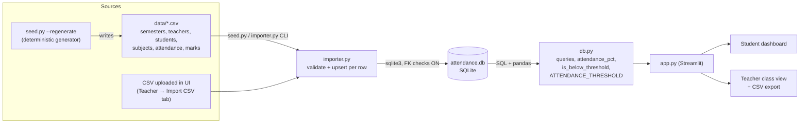
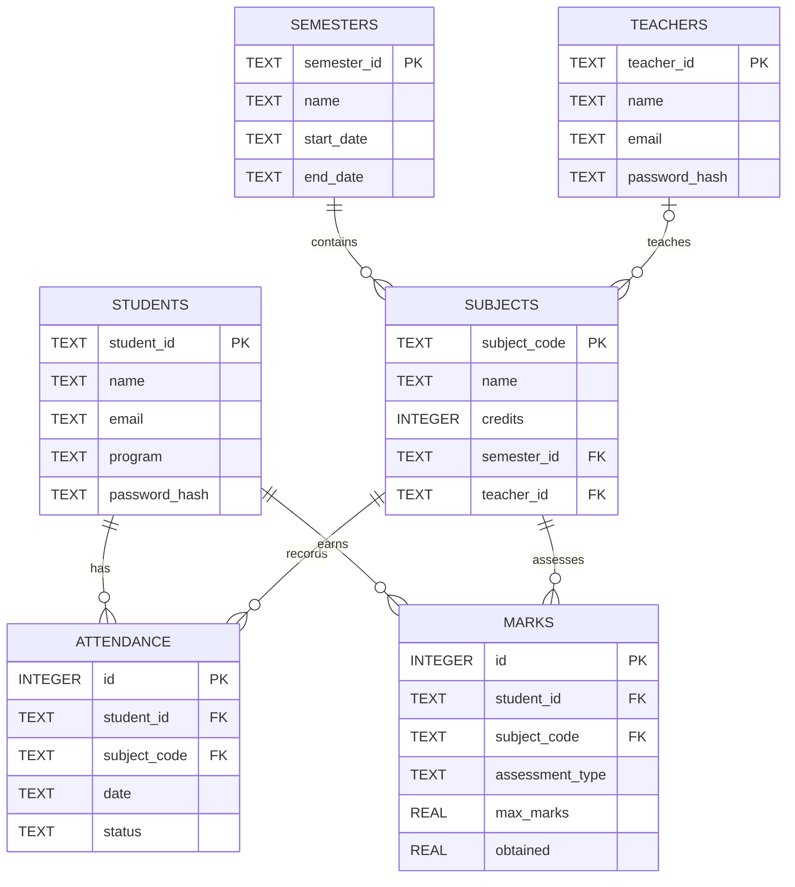

# Attendance & Marks System: Implementation Guide

This document explains everything in the repository: what it does, how it is built, how data flows, how every number is calculated, and how to run, extend and troubleshoot it. It describes the code as it exists in this repo.

---

## 1. Purpose and overview

Colleges often keep attendance, marks and semester subject details in separate spreadsheets. This project pulls them into **one SQLite database** and puts a **Streamlit web UI** on top of it:

- **Students** log in and see their own attendance % per subject and overall, their marks per subject and assessment, charts, and a clear warning when attendance is below the **75% threshold**.
- **Teachers** log in and see a **combined class view** (students × subjects) with attendance % and marks %, class averages, filters, students below 75% highlighted, CSV exports, and a **CSV upload** tab for importing new data.

Data gets in through **CSV files**. Sample CSVs live in `data/`. They are loaded by `seed.py`, the `importer.py` CLI, or the upload tab in the UI.

The 75% rule is defined **once** as `ATTENDANCE_THRESHOLD = 75.0` in `db.py`. Every flag, highlight, warning banner, chart reference line and label reads from that constant.

---

## 2. Architecture



Layers:

| Layer | File | Responsibility |
|---|---|---|
| Data generation | `seed.py` | Builds the realistic sample CSVs with a fixed seed. Resets the DB and imports all CSVs in dependency order. |
| Ingestion | `importer.py` | Validates and normalizes each CSV row, then upserts it into SQLite. Collects per-line errors. Also provides a CLI. |
| Data/logic | `db.py` | Schema DDL, connection helper, password hashing, the threshold constant, attendance %/flag functions, and the query functions that return pandas DataFrames. |
| Presentation | `app.py` | Streamlit UI: login sidebar, landing page, student dashboard, teacher dashboard (class view + import tab), and Altair charts. |

The database is opened per Streamlit script run (`db.get_connection()`) and closed at the end of the run. `init_db` runs `CREATE TABLE IF NOT EXISTS`, so the app never crashes on an empty or missing DB file. Instead it tells you to run `seed.py`.

---

## 3. Folder and file structure

```
attendance-marks-system/
├── app.py                 Streamlit application (entry point: streamlit run app.py)
├── db.py                  Schema, ATTENDANCE_THRESHOLD, calculations, queries
├── importer.py            CSV → DB import (library functions + CLI)
├── seed.py                Sample CSV generator + DB reset/seed script
├── data/
│   ├── semesters.csv      2 semesters
│   ├── teachers.csv       6 teachers
│   ├── students.csv       18 students
│   ├── subjects.csv       11 subjects (5 in SEM3, 6 in SEM4)
│   ├── attendance.csv     6,246 rows (student × subject × class date)
│   └── marks.csv          486 rows (student × subject × assessment)
├── tests/
│   └── test_attendance.py pytest tests: attendance %, <75% flag, DB-level aggregation, import validation
├── pytest.ini             pythonpath=. and testpaths=tests
├── requirements.txt       streamlit, pandas, altair, pytest
├── .gitignore             .venv, *.db, __pycache__, .pytest_cache, ...
├── README.md              Short overview + quick start
└── IMPLEMENTATION.md      This document
```

Generated at runtime (git-ignored): `attendance.db`, `.venv/`, `__pycache__/`, `.pytest_cache/`.

---

## 4. Tech stack

| Component | Version verified with | Requirement in `requirements.txt` |
|---|---|---|
| Python | 3.13.5 (Windows 11) | 3.10+ should work (uses only standard syntax); verified on 3.13 only |
| SQLite | bundled with Python's `sqlite3` module | n/a |
| Streamlit | 1.66.1 | `streamlit>=1.50` (the code uses `width="stretch"` and `Styler.map`) |
| pandas | 3.1.0 | `pandas>=2.2` |
| Altair | 6.3.0 | `altair>=5.0` |
| Jinja2 | 3.1.6 (pulled in transitively; needed for pandas `Styler`) | n/a |
| pytest | 9.2.0 | `pytest>=8.0` |

No ORM is used. Plain `sqlite3` with parameterized SQL keeps it simple.

---

## 5. Database schema

The DDL lives in `db.SCHEMA`. Foreign keys are enforced on every connection (`PRAGMA foreign_keys = ON`).

### 5.1 Tables

**`semesters`**

| Column | Type | Constraints | Notes |
|---|---|---|---|
| `semester_id` | TEXT | PRIMARY KEY | e.g. `SEM4` |
| `name` | TEXT | NOT NULL | e.g. `Semester 4 (Jul-Nov 2026)` |
| `start_date` | TEXT | NOT NULL | ISO `YYYY-MM-DD`; also used for ordering semesters |
| `end_date` | TEXT | NOT NULL | ISO `YYYY-MM-DD` |

**`teachers`**

| Column | Type | Constraints | Notes |
|---|---|---|---|
| `teacher_id` | TEXT | PRIMARY KEY | e.g. `T01` |
| `name` | TEXT | NOT NULL | |
| `email` | TEXT | | optional |
| `password_hash` | TEXT | NOT NULL | SHA-256 hex of the password |

**`students`**

| Column | Type | Constraints | Notes |
|---|---|---|---|
| `student_id` | TEXT | PRIMARY KEY | e.g. `S101` |
| `name` | TEXT | NOT NULL | |
| `email` | TEXT | | optional |
| `program` | TEXT | | optional, e.g. `B.Tech CSE` |
| `password_hash` | TEXT | NOT NULL | SHA-256 hex of the password |

**`subjects`**

| Column | Type | Constraints | Notes |
|---|---|---|---|
| `subject_code` | TEXT | PRIMARY KEY | e.g. `CS401` |
| `name` | TEXT | NOT NULL | |
| `credits` | INTEGER | NOT NULL, CHECK `credits > 0` | |
| `semester_id` | TEXT | NOT NULL, FK → `semesters.semester_id` | each subject belongs to exactly one semester |
| `teacher_id` | TEXT | FK → `teachers.teacher_id` (nullable) | the teacher who teaches it |

**`attendance`**

| Column | Type | Constraints | Notes |
|---|---|---|---|
| `id` | INTEGER | PRIMARY KEY AUTOINCREMENT | |
| `student_id` | TEXT | NOT NULL, FK → `students` | |
| `subject_code` | TEXT | NOT NULL, FK → `subjects` | |
| `date` | TEXT | NOT NULL | ISO date of the class |
| `status` | TEXT | NOT NULL, CHECK in (`present`, `absent`) | |
| | | UNIQUE (`student_id`, `subject_code`, `date`) | one record per student per class |

**`marks`**

| Column | Type | Constraints | Notes |
|---|---|---|---|
| `id` | INTEGER | PRIMARY KEY AUTOINCREMENT | |
| `student_id` | TEXT | NOT NULL, FK → `students` | |
| `subject_code` | TEXT | NOT NULL, FK → `subjects` | |
| `assessment_type` | TEXT | NOT NULL | stored lower-case; sample data uses `internal`, `midterm`, `final` |
| `max_marks` | REAL | NOT NULL, CHECK `max_marks > 0` | |
| `obtained` | REAL | NOT NULL, CHECK `0 <= obtained <= max_marks` | |
| | | UNIQUE (`student_id`, `subject_code`, `assessment_type`) | one score per assessment |

Indexes: `idx_att_student` on `attendance(student_id, subject_code)` and `idx_marks_student` on `marks(student_id, subject_code)`.

There is **no separate enrollment table**. A student counts as taking a subject when at least one attendance or marks row exists for that pair (see `subject_summary` in section 7).

### 5.2 ER diagram



---

## 6. CSV formats

General rules, as implemented in `importer.py`:

- The first line is the header. Header names are trimmed and lower-cased, so `Student_ID ` works. Extra columns are ignored.
- Every value is read as text (`dtype=str`, `keep_default_na=False`) and trimmed.
- Dates must be ISO `YYYY-MM-DD` (parsed with `date.fromisoformat`).
- Each row is **upserted**. A row whose key already exists updates the existing record instead of failing.
- Each row is processed on its own. Invalid rows are skipped and reported as `line N: reason`, where N is the line number in the file and the header is line 1. Valid rows are still imported and committed.
- **Import order matters** because of foreign keys: `semesters → teachers → students → subjects → attendance → marks`.

| Type | Required columns | Optional columns |
|---|---|---|
| `semesters` | `semester_id, name, start_date, end_date` | |
| `teachers` | `teacher_id, name` | `email, password` |
| `students` | `student_id, name` | `email, program, password` |
| `subjects` | `subject_code, name, credits, semester_id, teacher_id` | (`teacher_id` may be blank → NULL) |
| `attendance` | `student_id, subject_code, date, status` | |
| `marks` | `student_id, subject_code, assessment_type, max_marks, obtained` | |

Value rules:

- `password`: if the column is missing or blank, the default `pass123` (`db.DEFAULT_PASSWORD`) is used. The value is stored as a SHA-256 hash. The sample CSVs have no password column.
- `status`: case-insensitive. `present`, `p` or `1` maps to `present`. `absent`, `a` or `0` maps to `absent`. Anything else is rejected with `invalid status`.
- `credits`: integer > 0.
- `max_marks`, `obtained`: numbers with `0 <= obtained <= max_marks`.
- `assessment_type`: free text, stored lower-case. The UI orders `internal`, `midterm` and `final` first.

Example rows (taken from the shipped `data/` files):

```csv
# semesters.csv
semester_id,name,start_date,end_date
SEM3,Semester 3 (Jan-May 2026),2026-01-05,2026-05-15
SEM4,Semester 4 (Jul-Nov 2026),2026-07-06,2026-11-20

# teachers.csv
teacher_id,name,email
T01,Dr. Ananya Rao,rao.t01@example.edu

# students.csv
student_id,name,email,program
S101,Aarav Sharma,s101@example.edu,B.Tech CSE

# subjects.csv
subject_code,name,credits,semester_id,teacher_id
CS301,Data Structures,4,SEM3,T01

# attendance.csv
student_id,subject_code,date,status
S101,CS301,2026-01-05,present

# marks.csv
student_id,subject_code,assessment_type,max_marks,obtained
S101,CS301,internal,20,16.0
```

(The `# file.csv` lines are labels for this document only and are not part of the files.)

### 6.1 The shipped sample data (`seed.py`)

`seed.py` generates the CSVs from constants with `random.Random(42)`, so regenerating them gives the same files every time.

- **2 semesters**: `SEM3` (classes recorded 2026-01-05 to 2026-04-30, completed) and `SEM4` (classes recorded 2026-07-06 to 2026-10-23, in progress).
- **6 teachers** (`T01` to `T06`) and **18 students** (`S101` to `S118`, all `B.Tech CSE`).
- **11 subjects**. SEM3 has CS301, CS302, CS303, CS304 and HS301. SEM4 has CS401, CS402, CS403, CS404, MA401 and CS405. Each subject meets on two fixed weekdays, skipping a fixed holiday list, which gives **30 to 34 class sessions per subject**.
- **Attendance**: each student has a base attendance rate of uniform 0.82 to 0.96. There are three exceptions with low base rates (`S105` 0.66, `S111` 0.70, `S116` 0.62). Three student-subject pairs are deliberately weak (`S108`/CS402 0.60, `S103`/CS301 0.64, `S113`/MA401 0.66). Each subject adds ±0.04 of jitter, clamped to [0.40, 0.99]. Each class is then a Bernoulli draw at that rate.
- **Marks**: SEM3 has `internal`/20, `midterm`/30 and `final`/50. SEM4 has only `internal`/20 and `midterm`/30, because its final has not happened yet. The score fraction is `0.75·ability + 0.25·attendance_fraction ± 0.08`, clamped to [0.15, 1.0] and rounded to 0.5 marks. Ability is uniform 0.45 to 0.92 per student.

Actual outcome after seeding (verified):

| Scope | Students below 75% overall | Student-subject pairs below 75% |
|---|---|---|
| SEM3 | S105 (66.05%), S108 (74.69%), S116 (62.96%) | 16 |
| SEM4 (default view) | S105 (71.35%), S108 (70.27%), S116 (65.41%) | 17 |
| All semesters | S105 (68.88%), S108 (72.33%), S116 (64.27%) | 33 |

Edge cases worth demonstrating: `S111` is 76.08% overall (not flagged) but below 75% in CS301, CS303, CS403 and CS404. `S102`, `S103`, `S109`, `S113` and `S114` are fine overall but each has one low subject.

---

## 7. Calculations and the 75% flag

All of this lives in `db.py`.

```python
ATTENDANCE_THRESHOLD = 75.0

def attendance_pct(present, total):
    if not total:
        return None                     # no classes held → no percentage
    return round(100.0 * present / total, 2)

def is_below_threshold(pct, threshold=ATTENDANCE_THRESHOLD):
    return pct is not None and not pd.isna(pct) and pct < threshold
```

- **Attendance % (per student, per subject)** = `present / total_classes × 100`, rounded to 2 decimals. `total_classes` is the number of attendance rows for that student and subject. `None` is returned when there are no rows.
- **The flag is strict `<`**: exactly 75.00% is **not** flagged, but 74.99% is. A missing percentage (`None` or NaN) is never flagged.
- **Overall attendance %** (`overall_summary`) is **weighted by classes**: `Σ present / Σ total_classes` across the selected subjects. It is *not* the average of the subject percentages. Example: 7/30 in one subject and 9/10 in another gives 16/40 = 40%, not (23.3% + 90%) / 2. A test covers this.
- **Marks % per subject** = `Σ obtained / Σ max_marks × 100` over all recorded assessments for that subject. Because it uses raw sums, larger assessments carry more weight, so a final out of 50 counts more than an internal out of 20.
- **Overall marks %** = `Σ obtained / Σ max_marks` across all selected subjects. It is **not** weighted by credits.
- **Class averages (teacher view)**:
  - *Class avg attendance* and *Class avg marks* are the mean of each student's overall % over the filtered subjects.
  - *Class averages by subject* are the mean of the students' per-subject percentages, plus `students_below`, the count of students flagged in that subject.

`subject_summary(conn, student_id=None, semester_id=None)` is the main query. It aggregates attendance and marks per student and subject in two CTEs. It cross-joins students with subjects and left-joins the aggregates, **keeping only pairs that have some attendance or marks data**. It then adds `attendance_pct`, `marks_pct` and `below_threshold` in pandas. `overall_summary(df)` rolls that frame up to one row per student.

---

## 8. Login and roles

- The sidebar has a **Role** radio (Student / Teacher), a **User** dropdown (`ID - Name`, read from the DB), a **Password** field and a **Log in** button.
- The password is checked with `db.verify_login`, which compares the stored SHA-256 hash of the entered password. On success, `st.session_state["user"] = {"role", "id", "name"}` is set and the page reruns. **Log out** clears it.
- There are no other access controls. A student only sees their own data because every student query is filtered by the logged-in `student_id`.
- **Seeded credentials:** every student (`S101` to `S118`) and every teacher (`T01` to `T06`) has the password **`pass123`**. The login sidebar shows this hint.

---

## 9. Streamlit views

### 9.1 Landing page (not logged in)
This page explains the roles, states the threshold, and shows row counts per table, so an empty DB is obvious. If the DB has no users, the sidebar shows "Run `python seed.py` first."

### 9.2 Student dashboard
- **Semester selector**: defaults to the latest semester by `start_date`, with an "All semesters" option.
- **Warning banners**:
  - Red `st.error` when **overall** attendance is below 75%.
  - Amber `st.warning` listing **each subject** below 75% with its %.
  - Green `st.success` when nothing is below the threshold.
- **Metric tiles**: overall attendance % (with present/total classes), overall marks % (obtained/max), number of subjects, and number of subjects below 75%.
- **Per-subject summary table**: code, name, semester, credits, classes attended (`present/total`), attendance %, marks obtained/max, marks %, and status (`OK` or `BELOW 75%`). Attendance cells below 75% are shaded red.
- **Attendance by subject chart**: Altair bars that are green when OK and red when below, with a dashed red line at 75%.
- **Marks by assessment chart**: grouped bars of score % per subject, one bar per assessment type.
- **Marks detail table**: every assessment row with %.
- **Attendance log expander**: pick a subject to see each class date and present/absent.

### 9.3 Teacher dashboard
The caption lists the subjects the logged-in teacher teaches. There are two tabs.

**Class view tab**
- **Filters**:
  - Semester (defaults to the latest, with an "All semesters" option).
  - **Only my subjects** checkbox, which limits the view to subjects where `teacher_id` is the logged-in teacher.
  - **Subjects** multiselect. Leaving it empty means all subjects allowed by the other filters.
- **Metrics**: number of students, class average attendance %, class average marks %, and number of students below 75% overall. Overall figures always cover only the filtered subjects.
- **Combined class view (students × subjects)**: one row per student. The columns are `Student ID`, `Student`, `Overall Att %`, `Overall Marks %`, then a `<code> Att %` and `<code> Marks %` pair for each subject, then `Flag`. Every attendance cell below 75% is shaded red. `Flag` is `BELOW 75%` when overall attendance is below the threshold. Otherwise it reads `Low in CS301, CS403` when only some subjects are low, and it is empty when the student is fine. **Export class view (CSV)** downloads this table as `class_view.csv`.
- **Class averages by subject**: a table of average attendance %, average marks % and the number of students below 75% for each subject, plus the same green/red bar chart with the 75% line.
- **Flagged list**: every student-subject pair below 75%, with present/total and %. **Export flagged list (CSV)** downloads it as `below_threshold.csv`.
- **Detailed records expander**: one row per student-subject pair with attendance counts and %, the obtained score for each assessment (`internal`, `midterm`, `final`), totals, marks % and `below_threshold`. **Export detailed records (CSV)** downloads it as `detailed_records.csv`.

**Import CSV tab**
- Choose the data type. The required columns are listed, and the recommended import order is shown.
- Upload a `.csv`. The tab previews the first 20 rows and shows the row count.
- **Import** runs the same `importer.import_csv` used by the CLI. It shows the number of imported rows, up to 50 skipped-row errors, and the new table counts. The class view picks up the data on the next interaction.

---

## 10. Setup from a clean machine

Prerequisites: Python 3.10 or newer (verified with 3.13) and pip. Git is optional.

### Windows (PowerShell)
```powershell
cd C:\path\to\attendance-marks-system
python -m venv .venv
.\.venv\Scripts\Activate.ps1          # if blocked: Set-ExecutionPolicy -Scope CurrentUser RemoteSigned
python -m pip install --upgrade pip
pip install -r requirements.txt
python seed.py
streamlit run app.py
```
Without activating the venv, you can call `.\.venv\Scripts\python.exe -m streamlit run app.py` and similar commands directly.

### Linux / macOS
```bash
cd /path/to/attendance-marks-system
python3 -m venv .venv
source .venv/bin/activate
python -m pip install --upgrade pip
pip install -r requirements.txt
python seed.py
streamlit run app.py
```

Open http://localhost:8501 in a browser. Use `--server.port 8600` to change the port and `--server.headless true` on servers.

---

## 11. Running, testing, resetting

| Task | Command |
|---|---|
| Seed / **reset** the DB (drops all tables, re-imports `data/*.csv`) | `python seed.py` |
| Regenerate the sample CSVs, then reseed | `python seed.py --regenerate` |
| Seed into a different DB file | `python seed.py --db other.db` |
| Import one CSV (CLI) | `python importer.py <type> <file.csv> [--db path]` |
| Start the app | `streamlit run app.py` |
| Start headless on a port | `streamlit run app.py --server.headless true --server.port 8599` |
| Run tests | `pytest` (or `pytest -v`) |
| Use a different DB in the app | set `AMS_DB_PATH` (PowerShell: `$env:AMS_DB_PATH="C:\data\x.db"`; bash: `export AMS_DB_PATH=/data/x.db`) |
| Wipe completely | delete `attendance.db` and run `python seed.py` |

`importer.py` exits with code 1 if any row failed. `seed.py` exits with code 1 if any sample row failed.

Tests (`tests/test_attendance.py`, 18 cases):
- The threshold constant equals 75.
- `attendance_pct` values, including rounding and the zero-classes case returning `None`.
- `is_below_threshold` boundaries (74.99 → True, 75.0 → False, None/NaN → False) and a custom threshold.
- Per-subject and overall flags computed from a temporary SQLite DB.
- Overall % is class-weighted.
- An invalid attendance status is rejected by the importer.

---

## 12. Extending the data

All additions go through CSV imports, either the **Import CSV tab** or `importer.py`. Because rows are upserted, a file can mix new rows and corrections.

1. **New semester**: add a row to a semesters CSV, e.g. `SEM5,Semester 5 (Jan-May 2027),2027-01-04,2027-05-14`, and import it as `semesters`. It appears in both semester selectors, ordered by `start_date`. The latest one becomes the default.
2. **New teacher**: import `teacher_id,name,email[,password]`.
3. **New subject**: import `subject_code,name,credits,semester_id,teacher_id`. The semester and teacher must already exist, or the row fails with `FOREIGN KEY constraint failed`.
4. **New students**: import `student_id,name,email,program[,password]`.
5. **Attendance and marks**: import rows referencing existing student IDs and subject codes. A subject/student pair appears in the views as soon as it has any attendance or marks row.

To change the **shipped** sample data permanently, edit the constants at the top of `seed.py` (`SEMESTERS`, `TEACHERS`, `SUBJECTS`, `STUDENTS`, `HOLIDAYS`, `LOW_ATTENDANCE`, `WEAK_SUBJECT`, `ASSESSMENTS`) and run `python seed.py --regenerate`.

To change the **threshold**, edit `ATTENDANCE_THRESHOLD` in `db.py`. The UI text, highlights, flags and charts all follow it. The test `test_threshold_is_single_constant_of_75` would then need updating.

Caution: `python seed.py` **drops all tables**. Data imported through the UI is lost unless it is also in `data/*.csv`.

---

## 13. Verification performed (real results)

These checks were run on Windows 11 with Python 3.13.5 in the project's `.venv`.

1. **Install**: `pip install streamlit pandas altair pytest` gave streamlit 1.66.1, pandas 3.1.0, altair 6.3.0 and pytest 9.2.0.
2. **Seed**: `python seed.py --regenerate`
   ```
   Generated CSVs: {'semesters': 2, 'teachers': 6, 'students': 18, 'subjects': 11, 'attendance': 6246, 'marks': 486}
   semesters   imported     2 rows, 0 errors
   teachers    imported     6 rows, 0 errors
   students    imported    18 rows, 0 errors
   subjects    imported    11 rows, 0 errors
   attendance  imported  6246 rows, 0 errors
   marks       imported   486 rows, 0 errors
   ```
3. **Tests**: `pytest -v` gave `18 passed in 4.29s`.
4. **Importer error handling** (CLI, with a deliberately bad file): `attendance: imported 1 rows, 3 errors`
   ```
   line 3: FOREIGN KEY constraint failed          (unknown student S999)
   line 4: Invalid isoformat string: '26/10/2026'
   line 5: invalid status 'late' (use present/absent)
   ```
   The exit code was 1.
5. **UI script execution** (Streamlit `AppTest`, run from a scratch script that is not part of the repo). No exceptions occurred on the landing page, the student dashboards (`S116` flagged, `S101` clean, `S111` across all semesters), or the teacher view (`T01`, plus `T02` with All semesters, Only my subjects and a single-subject filter). A wrong password showed "Invalid password." and `pass123` logged in. Sample metrics:
   - `S116`: overall attendance 65.4%, 5 of 6 subjects below 75%, red banner shown.
   - `T01` (SEM4): 18 students, class average attendance 84.2%, marks 73.4%, 3 students below 75%.
6. **Headless boot**: `streamlit run app.py --server.headless true --server.port 8599` returned `GET /` 200 and `GET /_stcore/health` 200 (`ok`) about 2 seconds after start. The process was then stopped.

Not verified: the visual appearance in a real browser (no screenshots were taken), the file-upload widget clicked through a browser (the same import code path was tested through the CLI and tests), and Linux/macOS runs.

---

## 14. Troubleshooting

| Symptom | Cause / fix |
|---|---|
| Sidebar says "No users in the database" | The DB is empty. Run `python seed.py` from the project folder (or the folder `AMS_DB_PATH` points to). |
| `streamlit: command not found` / not recognized | The venv is not activated. Activate it, or run `python -m streamlit run app.py`. |
| `Activate.ps1 cannot be loaded because running scripts is disabled` | Run `Set-ExecutionPolicy -Scope CurrentUser RemoteSigned`, or call `.\.venv\Scripts\python.exe` directly. |
| `Port 8501 is already in use` | Start with `--server.port 8502`, or stop the other Streamlit process. |
| Import errors `FOREIGN KEY constraint failed` | The referenced semester, teacher, student or subject does not exist yet. Import in the order `semesters → teachers → students → subjects → attendance → marks`. |
| `Invalid isoformat string` | Dates must be `YYYY-MM-DD`. |
| `missing required columns: ...` | Check the header names against section 6. |
| `obtained X outside 0..Y` | The score is larger than `max_marks` or negative. |
| `database is locked` | Another process (e.g. a DB browser) holds a write lock. Close it and retry. |
| Can't log in after re-importing students/teachers | Re-importing without a `password` column resets those users to `pass123` (see limitations). |
| `ModuleNotFoundError: db` when running pytest | Run `pytest` from the project root. `pytest.ini` sets `pythonpath = .`. |

---

## 15. Limitations and next steps

Limitations (intentional, to keep it simple):
- **Auth is demo-grade.** It uses unsalted SHA-256, a shared default password shown in the UI, and no sessions beyond Streamlit's in-memory state. Any teacher can see all subjects and import data.
- **No enrollment table.** Enrollment is inferred from attendance/marks rows. A student with no rows in a subject does not appear for it.
- **Re-importing** students or teachers without a `password` column overwrites their password hash with the default.
- **Marks % uses raw sums.** It does not weight assessments by a scheme, and overall marks are not credit-weighted.
- **There is no delete or edit UI.** Corrections are made by re-importing (upsert), and deletions require SQL.
- **One class/program** in the sample data. There are no sections or batches.
- `seed.py` resets the whole database.

Possible next steps:
- Use proper auth (salted hashes such as `bcrypt`, per-user password change, and restricting teachers to their own subjects).
- Add an `enrollments` table and support sections/batches.
- Add configurable assessment weights and credit-weighted GPA/CGPA.
- Add in-app attendance marking for a class date, plus edit and delete actions.
- Add trend charts (attendance over time) and an early-warning projection ("classes needed to reach 75%").
- Move to SQLAlchemy/PostgreSQL for multi-user deployments and add an app-level test suite with `streamlit.testing.v1.AppTest`.
